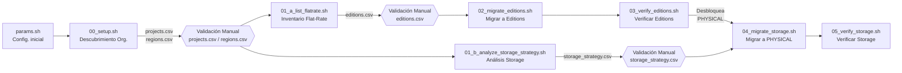

# Migración Organizacional de BigQuery: Flat-Rate a Editions y Almacenamiento Físico

**Alcance:** Migración a escala organizacional desde reservas heredadas **Flat-Rate** y almacenamiento **Lógico (`LOGICAL`)** hacia **BigQuery Editions** y almacenamiento **Físico (`PHYSICAL`)**.

> **Principio de Secuenciación:** BigQuery impide cambiar el modelo de almacenamiento de un dataset a `PHYSICAL` mientras su proyecto propietario siga asignado a una reserva de slots *Flat-Rate* heredada. Por ello, la migración y verificación de reservas a **Editions (`02` → `03`)** debe completarse siempre antes de migrar datasets a **Almacenamiento Físico (`04` → `05`)**.

---

## 1. Arquitectura y Flujo con Validaciones Manuales

Todos los scripts son autocontenidos y no requieren parámetros por línea de comandos: leen la configuración global desde `params.sh` y operan sobre archivos CSV intermedios que actúan como **compuertas de validación manual** antes de aplicar cualquier cambio en producción.



---

## 2. Configuración Inicial y Puntos de Control Manual

1. **Configurar `params.sh`:**
   * Definir `ORG_NAME` con el dominio textual de la organización.
   * Ajustar valores sugeridos por defecto: `TARGET_EDITION` (`ENTERPRISE`), `DISCOUNT_MULTIPLIER` (multiplicador contractual sobre precio lista, ej. `0.85`), `MIN_MONTHLY_SAVINGS` y `DRY_RUN` (`"true"` para simular sin mutar recursos).
2. **Validación Manual 1 — `projects.csv` y `regions.csv` (tras `00_setup`):**
   * Verificar la lista de proyectos y regiones con uso activo en la organización. Permite acotar la ejecución por oleadas (dejando solo ciertas regiones o proyectos) o agregar algún proyecto administrador destino adicional.
3. **Validación Manual 2 — `editions.csv` (tras `01_a_list_flatrate`):**
   * Revisar y aprobar por cada reserva *Flat-Rate*: el proyecto destino (`target_admin_project`), nombre destino (`target_reservation`), edición (`target_edition`), capacidad (`baseline_slots` y `autoscale_max_slots`, múltiplos de 50) y si se eliminará la reserva *Flat-Rate* una vez vaciada (`delete_flat_rate`).
4. **Validación Manual 3 — `storage_strategy.csv` (tras `01_b_analyze_storage_strategy`):**
   * Revisar los ratios de compresión, el costo de *Time Travel* / *Fail-Safe* y el beneficio neto mensual estimado, ajustando `recommend_migrate` (`true`/`false`) antes de aplicar el cambio (considerando la ventana de bloqueo de 14 días de BigQuery tras cambiar el modelo de facturación de un dataset).

---

## 3. Ejecución Paso a Paso y Comando Clave por Etapa

Todos los scripts se ejecutan desde la raíz del repositorio con `bash scripts/<nombre>.sh` (también admiten `./scripts/<nombre>.sh` o `sh scripts/<nombre>.sh`).

### `00_setup` — Descubrimiento Organizacional (`00_setup.sh`)
Traduce el nombre textual de la organización (`ORG_NAME`) a su `ORG_ID` numérico e identifica todos los proyectos y regiones con datasets o reservas activas, generando `projects.csv` y `regions.csv`.

* **Cómo ejecutar:**
  ```bash
  bash scripts/00_setup.sh
  ```
  *(Revisar manualmente `projects.csv` y `regions.csv` antes de avanzar).*
* **Comando clave interno:**
  ```bash
  gcloud organizations list --filter="displayName=${ORG_NAME}" --format="value(ID)"
  gcloud asset search-all-resources --scope="organizations/${ORG_ID}" --asset-types="bigquery.googleapis.com/Dataset,bigqueryreservation.googleapis.com/Reservation"
  ```

### `01_analyze` — Diagnóstico de Reservas y Almacenamiento
* **`01_a_list_flatrate.sh`:** Recorre `projects.csv` y `regions.csv` listando todas las reservas *Flat-Rate* (`edition` sin definir / `EDITION_UNSPECIFIED`) y el conteo de sus asignaciones en `editions.csv`.
  * **Cómo ejecutar:**
    ```bash
    bash scripts/01_a_list_flatrate.sh
    ```
    *(Validar manualmente `editions.csv` antes de ejecutar el paso `02`).*
  * **Comando clave interno:**
    ```bash
    bq ls --reservation --project_id="${PROJECT_ID}" --location="${REGION}" --format=json
    ```

* **`01_b_analyze_storage_strategy.sh`:** Calcula en cada proyecto y región el peso lógico vs. físico (incluyendo *Time Travel* y *Fail-Safe*) y la eficiencia mensual proyectada en `storage_strategy.csv`.
  * **Cómo ejecutar:**
    ```bash
    bash scripts/01_b_analyze_storage_strategy.sh
    ```
    *(Validar manualmente la columna `recommend_migrate` en `storage_strategy.csv` antes de ejecutar el paso `04`).*
  * **Comando clave interno:**
    ```sql
    SELECT project_id, table_schema, SUM(active_logical_bytes), SUM(active_physical_bytes + fail_safe_physical_bytes)
    FROM `${PROJECT_ID}`.`region-${REGION}`.INFORMATION_SCHEMA.TABLE_STORAGE
    WHERE deleted = FALSE GROUP BY 1, 2
    ```

### `02_migrate_editions` — Migración de Reservas (`02_migrate_editions.sh`)
Crea cada reserva de BigQuery Editions en el `target_admin_project` validado en `editions.csv` y traslada las asignaciones (`PROJECT`, `FOLDER` u `ORGANIZATION`) desde la reserva *Flat-Rate* origen.

* **Cómo ejecutar:**
  ```bash
  # Previsualización sin aplicar cambios (opcional)
  bash scripts/02_migrate_editions.sh --dry-run

  # Ejecución efectiva
  bash scripts/02_migrate_editions.sh
  ```
* **Comando clave interno:**
  ```bash
  bq mk --reservation --project_id="${TARGET_ADMIN_PROJECT}" --edition="${TARGET_EDITION}" --slots="${BASELINE_SLOTS}" --autoscale_max_slots="${AUTOSCALE_MAX_SLOTS}" "${TARGET_RESERVATION}"
  bq update --reservation_assignment --destination_reservation_id="${TARGET_ADMIN_PROJECT}:${LOCATION}.${TARGET_RESERVATION}" "${SOURCE_ADMIN_PROJECT}:${LOCATION}.${FLAT_RATE_RESERVATION}.${ASSIGNMENT_ID}"
  ```

### `03_verify_editions` — Verificación de Editions (`03_verify_editions.sh`)
Audita que cada reserva destino exista en su `target_admin_project` con la edición y *slots* esperados, y certifica en `projects.csv` y `regions.csv` que ninguna reserva *Flat-Rate* conserve asignaciones activas.

* **Cómo ejecutar:**
  ```bash
  bash scripts/03_verify_editions.sh
  ```
* **Comando clave interno:**
  ```bash
  bq show --reservation --project_id="${TARGET_ADMIN_PROJECT}" --location="${LOCATION}" --format=json "${TARGET_RESERVATION}"
  ```

### `04_migrate_storage` — Migración a Almacenamiento Físico (`04_migrate_storage.sh`)
Actualiza a facturación `PHYSICAL` todos los datasets aprobados (`recommend_migrate = true`) en `storage_strategy.csv` mediante actualización directa de metadatos del dataset.

* **Cómo ejecutar:**
  ```bash
  # Previsualización sin aplicar cambios (opcional)
  bash scripts/04_migrate_storage.sh --dry-run

  # Ejecución efectiva (correr únicamente tras superar 03_verify_editions)
  bash scripts/04_migrate_storage.sh
  ```
* **Comando clave interno:**
  ```bash
  bq update --dataset --storage_billing_model=PHYSICAL "${PROJECT_ID}:${DATASET_ID}"
  ```

### `05_verify_storage` — Verificación de Almacenamiento (`05_verify_storage.sh`)
Comprueba sobre cada dataset elegible que la propiedad `storageBillingModel` reporte efectivamente `PHYSICAL`, emitiendo el reporte de auditoría `storage_verification.csv`.

* **Cómo ejecutar:**
  ```bash
  bash scripts/05_verify_storage.sh
  ```
* **Comando clave interno:**
  ```bash
  bq show --format=json "${PROJECT_ID}:${DATASET_ID}" | jq -r '.storageBillingModel // "LOGICAL"'
  ```

---

## 4. Permisos IAM Requeridos a Nivel Organización

* **`roles/resourcemanager.organizationViewer`** y **`roles/resourcemanager.folderViewer`** *(más `roles/cloudasset.viewer` opcional)* — Resolución de organización, jerarquía de carpetas e inventario en `00_setup`.
* **`roles/bigquery.resourceAdmin`** — Lectura de reservas, creación en proyectos administradores destino y reasignación de cargas en `01_a`, `02` y `03`.
* **`roles/bigquery.dataOwner`** *(o rol personalizado con `bigquery.datasets.get`, `bigquery.datasets.update` y `bigquery.tables.list`)* — Análisis de `TABLE_STORAGE` y actualización de `storage_billing_model` en `01_b`, `04` y `05`.
